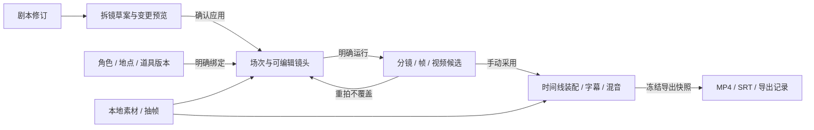

# Frameforge 短剧制作闭环与竞品缺口设计

- 日期：2026-11-22；状态：已进入 P1 实现。本文仍是产品边界与验收依据；实现进度与发布阻断记录在配套计划和发布证据中。
- 基线：`e1f56d9`，以当前画布入口、节点注册表和 Tauri IPC 为准；路线图、旧版快照与竞品宣传均不算当前可用能力。
- 上位文档：[Frameforge Canvas Studio 总体设计](2026-10-31-canvas-studio-design.md)。本文将其 P1–P6 展开为面向当前代码的补齐方案。遇到不同取舍时，本文仅提出本轮交付范围内的约束，待评审后再回写总体设计。
- 适用对象：产品、设计、前端、Rust/媒体后端、测试；优先服务一人剧组和小型短剧工作室。

**阅读索引**：产品评审看 §1–4 和 §16；工程设计看 §5–12；排期与验证看 §13–15。

## 1. 要解决的问题

Frameforge 已能在本地画布上配置模型、生成图/视频/语音、选择候选并记录运行历史。制作一集短剧时，用户仍然需要手工把剧本文字变成镜头节点，逐镜管理参考素材，在外部工具组装和导出。增加几个生成节点不会消除这些断点。

**首个可交付场景**：创作者导入一段中文剧本，审阅并应用三镜草案，给三镜绑定同一角色版本，通过素材导入或远程生成得到片段，在画布内排片、混入旁白、调整字幕并导出竖屏 MP4。随后重拍第二镜，明确采用新版本，只更新这一镜，重新交付。重启后能找到之前选用的版本与导出记录。

| 原则 | 可观察行为 |
|---|---|
| 画布为主要操作入口 | 镜头列表、主体库和时间线与画布相互定位；不恢复旧版多页面向导作为第二套编辑器 |
| 本地优先 | 不登录即可使用本地素材编辑和导出；配置远程生成后，只有明确确认的输入才会发送给指定服务 |
| 编辑和执行分离 | 改稿、应用拆镜、换素材、套模板只改数据，不自动产生付费生成 |
| 结果可复用、可追溯 | 每个已采用镜头、时间线片段和文件都可追到资产、版本、来源；意外切换供应商或候选不会改写已交付结果 |
| 允许人修正 AI | 拆镜、引用选择、采用镜头、导出告警均有可见的确认点；推断结果不冒充事实或人工审批 |

**非目标**：P1 不替代专业非线编，不做多视频轨、关键帧动画、在线多人编辑、Agent 自主付费、动作捕捉、第三方代码插件；不保证模型生成的角色脸永不漂移，也不以接入模型数量作为验收。无分发许可的媒体组件不能作为发行包依赖。

**建议的 P1 发布口径**：第 14 节四个切片、第 15 节 A01–A08 和媒体发行门禁共同决定是否发布。内置「竖屏三镜」模板、首/尾帧逐项生成和配置好供应商后的真实生成冒烟均在范围内；真实冒烟不绑定唯一厂商。相较总体设计 §17.2，本文建议将 Shot 自动一条龙、展开成子图、跨设备完整导入移到 P2；本地素材起步不要求跑真实模型。此处是待批准的调整，不静默修改总体设计。

## 2. 竞品证据与交付边界

下表反映公开文档或发布信息，不代表各套餐、地区都可用，也不等同于实际效果测试。型号列表随时变化；本文主要比较工作流而不是型号。

| ID | 缺口 | 竞品证据 | 当前 Frameforge | 拟交付 |
|---|---|---|---|---|
| G01 | 剧本创编→场次、镜头 | [LibTV 发布说明](https://mp.weixin.qq.com/s/C7xUcSWVXLYfexbFIeI8Jw)、[LTX Studio Storyboard](https://ltx.io/studio/platform/ai-storyboard-generator) | 可填剧本正文；无结构化编译、审阅和建镜 | P1：拆镜和差异预览；P2：跨集管理、选区精修 |
| G02 | 命名主体、版本和跨镜引用 | [TapNow 主体库](https://docs.tapnow.ai/zh/docs/canvas/create-and-use-elements)、[LTX Elements](https://help.ltx.io/hc/en-us/p/ltx-studio) | 三视图、造型变体、拆格、选参考图和单节点锁定；无主体档案 | P1：项目内主体与版本；P2：跨项目复制、选造型与批量升级 |
| G03 | 素材进画布及视频抽帧 | [TapNow 本地素材](https://docs.tapnow.ai/en/docs/canvas/upload-files-to-the-canvas)、[TapNow 视频操作](https://docs.tapnow.ai/en/docs/canvas/generate-and-edit-video) | 支持旧项目导入；通用本地媒体入口、从视频裁取帧并接下一镜未接入 | P1：导入、拖入、抽帧和复用；P2：批量管理与剪贴板 |
| G04 | 时间线、字幕、音轨与交付 | [TapNow Playlist](https://docs.tapnow.ai/en/docs/canvas/use-playlists)、[LTX Studio 交付](https://ltx.studio/platform/ai-movie-maker) | 导出当前是元数据 JSON，不是 MP4；旧版合成 UI 和 Rust 历史代码未接入当前应用 | P1：单视频主轨、音频、字幕、MP4/SRT；P2：提案图、可迁移项目包；P6：剪辑交接格式、多规格批量 |
| G05 | 工作流复用、批量重拍 | [TapNow 模板与整组运行](https://docs.tapnow.ai/en/docs/canvas/use-library-and-templates) | 编组、单节点执行、费用确认、候选历史已在；无可复用子图模板或整组计划 | P1：内置短剧模板、单镜重拍；P2：保存/套用子图、批次计划与审批 |
| G06 | 拉片与精准视频编辑 | [LibTV 发布说明](https://mp.weixin.qq.com/s/C7xUcSWVXLYfexbFIeI8Jw)、[TapNow 视频编辑](https://docs.tapnow.ai/en/docs/canvas/generate-and-edit-video)（Retake 为 Beta） | 支持视频生成与参考输入，不等于能分析或原位修改已有视频 | P1：非破坏性基础裁切；P3：镜头切分、分析、延长与选区重拍 |
| G07 | 导演预演、音频生产 | [LibTV 3D-BOX](https://www.liblib.tv/3d-box)、[TapNow 音频](https://docs.tapnow.ai/en/docs/canvas/generate-and-edit-audio) | 多机位是静态宫格；音频节点主要是 TTS | P1：导入音频、混音；P3：机位灯光预演、音乐/音效能力 |
| G08 | 审片、实时协作 | [TapNow 团队协作](https://docs.tapnow.ai/zh/docs/projects/create-with-your-team)、[LTX Studio 分享](https://help.ltx.io/hc/en-us/articles/33649840422802-Sharing-your-project) | 多张本地画布，无邀请、角色权限、在线评论或实时同步 | P2：本地状态和可分享审片交付物；P5：权限、评论与多人同步 |
| G09 | Agent、外部调用与生态 | [LibTV OpenAPI Skill](https://github.com/libtv-labs/libtv-skills)、[LibTV Codex 插件](https://github.com/liblib-ai/marketplace) | 有模型网关与应用内命令，无导演 Agent、MCP 或插件 SDK | P4：审阅式导演 Agent 与本地接口；P6：声明式扩展、ComfyUI 适配 |

## 3. 备选方案与优先级

| 方案 | 好处 | 代价与判断 |
|---|---|---|
| A. 继续补原语节点，用连线手搭制作流程 | 实现快，对当前节点体系影响小 | 每个创作者都要重复搭图；同一镜头及同一角色在不同画布没有稳定身份。不能解决版本替换和跨镜头连续性 |
| **B. 画布上增加项目级实体，再以现有节点承接生成（建议）** | 剧本、镜头、主体、时间线各有稳定 ID；旧节点仍可独立使用；单人闭环能先交付 | 需要明确实体/节点的所有权、事务、历史以及资产引用规则；先做小范围兼容层，不重写全应用 |
| C. 先做自动导演或完整剪辑器 | 容易演示单点亮点 | 缺编辑与恢复契约时，Agent 只会堆节点；完整剪辑器投入较大，也不能替代拆镜和主体复用 |

推荐先用已有视频验证「导入 → 装配 → 导出」，再接入结构化拆镜、角色版本和已有生成网关。两端接通之后再上整组编排和 Agent；同一命令只能有一套校验与付费授权规则。



## 4. 交互与端到端流程

### 4.1 工作区与导航

| 区域 | P1 内容与行为 |
|---|---|
| 左栏「制作」 | 剧本、当前集场次、镜头树；支持按编号、场次和缺素材状态筛选。选镜头高亮画布和时间线，不改变其他数据 |
| 左栏「素材」 | 本地导入、类型过滤、名称搜索、镜头引用；能从素材创建可连线的源节点。按项目分页，不截断成固定前 N 条 |
| 左栏「主体」 | 角色、地点、道具；显示当前启用版本和已使用镜头，支持从已有设定图/拆格创建版本 |
| 中央画布 | 保留原语节点、分组、连线和快捷键；新增镜头卡与合成卡。已有同名三视图、宫格节点不变更类型和默认语义 |
| 右侧 Inspector | 镜头规格、当前采用素材、生成候选、主体引用、实际发送的参考和能力限制。错误可跳转到缺失素材或不兼容设置 |
| 底部时间线抽屉 | 默认收起；支持片段排序/裁切/拆分、播放头、旁白和音乐导入、字幕列表编辑、导出进度。输入框编辑时不抢画布快捷键 |

新增操作统一提供键盘可用的按钮或列表选项，不只依赖拖拽；运行中、缺素材、待重跑同时用文字/图标表达，不能只靠颜色。选择与播放头是会话状态，不写入运行快照。

### 4.2 新项目和旧项目各有入口

1. **剧本起步**：新建项目 → 应用「竖屏三镜」模板 → 粘贴或导入剧本 → 明确发起拆镜 → 审阅并应用 → 确认主体参考 → 逐镜生成或导入素材 → 采用 → 装配 → 导出。
2. **素材起步**：把已有片段拖入画布 → 多选建立合成 → 裁切排序 → 添加旁白和字幕 → 导出。无 Provider、无剧本或未使用镜头实体时没有不必要的阻断。
3. **继续现有项目**：旧图照常打开。仅在用户选择「从节点新建镜头」「将候选设为镜头产物」等操作时建立实体绑定；不从所有旧分组或参考边推断剧本。
4. **返工**：点击第二镜的「重新生成」→ 生成新的候选 → 预览和采用 → 查看时间线的「有新版本」提示 → 明确替换第二镜 → 重新导出。第一、第三镜及第一次导出不变。

### 4.3 三类状态分开表达

| 状态 | 对象 | 语义 |
|---|---|---|
| 执行状态 | Run / Job | 排队、运行、成功、失败、取消；表示一次技术执行，不等于创作通过 |
| 素材选用状态 | 镜头产物槽 / TimelineClip | 未选用、已采用、已有不同候选或输入过期。副本里采纳的仍然是原资产，直至显式更换 |
| 制作审批 | 镜头 / 时间线 | `draft → review → approved / rejected`；镜头审批固定到规格快照与具体采纳记录，时间线审批固定到剪辑内容快照。修改影响交付的内容后回到 `draft`，保留上次审批快照。P1 是本地人工标记，不是在线权限或流程审批 |

## 5. 领域模型、持久化和事务

### 5.1 数据所有权

| 对象 | 权威来源 | 核心不变量 |
|---|---|---|
| Board | `boards.payload` + 写入修订号 | 节点、边、布局、视口；节点通过 `entityId` 指向领域数据，不复制主体或镜头表 |
| Script / Episode / Scene / Shot / Subject / Timeline | 项目级实体表 | 一个实体可由多张画布引用，编辑的是同一个对象；项目 ID 不可跨引用变更 |
| SubjectVersion | 不可变版本记录 | 同一主体的新版本不能覆盖历史，镜头绑定显式具体版本，不追随「当前版本」 |
| Asset | CAS 内容哈希 + SQLite 元数据 | 内容不可变；项目成员关系与生成/导入来源独立于物理去重，不能用单个 `provenance.projectId` 判断归属 |
| Run / Job | 现有运行记录 + 按操作扩展的快照 | 审计一次执行与失败，不是镜头选用或剪辑的权威来源 |
| Export | 导出记录与不可变输入快照 | 后续镜头、字幕、源素材引用变化不重写历史结果；用户目标路径只在本机保留 |

### 5.2 最小数据契约

以下是提议的数据形状，不代表当前源码。具体 DTO 使用严格字段校验，所有写入引用需验证实体类型、项目归属、版本及素材是否存在；创建新项目时可从空实体集开始。

```ts
type ReviewState = 'draft' | 'review' | 'approved' | 'rejected';
type ProjectEntityKind = 'script' | 'episode' | 'scene' | 'shot' | 'subject' | 'timeline';
type SubjectKind = 'character' | 'location' | 'prop';
type ShotSlot = 'storyboard' | 'firstFrame' | 'lastFrame' | 'video' | 'dialogue';

interface EntityEnvelope<T> {
  id: string;
  projectId: string;
  kind: ProjectEntityKind;
  schemaVersion: number;
  revision: number;
  archivedAt?: string;
  updatedAt: string;
  data: T;
}

interface SourceSpan {
  scriptId: string;
  scriptRevision: number;
  startLine: number;
  endLine: number;
}

interface SubjectVersion {
  subjectId: string;
  ordinal: number;
  descriptor: string;
  references: { slot: string; assetId: string; priority: number }[];
  voice?: { providerId: string; modelId: string; voiceId: string };
  createdAt: string;
}

interface SubjectBinding {
  bindingId: string;
  subjectId: string;
  version: number;
  notes?: string;
}

interface AdoptedMedia {
  adoptionId: string;
  assetId: string;
  sourceRunId?: string;
  inputHash?: string;
  adoptedAt: string;
}

interface ShotData {
  sceneId: string;
  order: number;
  source?: SourceSpan;
  spec: {
    action: string;
    dialogue: { speakerBindingId?: string; speakerLabel?: string; text: string }[];
    framing: string;
    angle: string;
    cameraMove: string;
    durationMs: number;
    notes?: string;
  };
  bindings: SubjectBinding[];
  previousShotId?: string;
  selected: Partial<Record<ShotSlot, AdoptedMedia>>;
  review: ReviewState;
  approvedSpecHash?: string;
}
```

- 剧本保存 `title/body/format`、来源文件显示名及修订；编号为集→场→镜派生的展示值，不作主键。集记录 `scriptId/order/title`；场记录 `episodeId/order/heading/source`；镜头由 `sceneId` 归属当前集。同父范围顺序变更原子重排，跨场移动保留镜头 ID。
- `Subject` 保存 `kind/name/aliases/currentVersion`；同项目同类型的规范化名称冲突时展示合并提示，不自动合并。档案及旧版本仍可显示在已有镜头内；P1 跨项目直接引用拒绝，P2 通过明确复制创建目标项目档案与引用。
- 每次「采用」写入不可变的 `ShotAdoption`，保存镜头 ID、槽位与该次 `AdoptedMedia`。镜头的 `selected` 为当前记录的事务内投影，旧记录可通过 `adoptionId` 从时间线、导出快照追溯。撤销或切回旧版只改变当前指向。
- 镜头审批记录固定 `shotId/specHash/videoAdoptionId`；时间线审批固定到 `timelineId/editHash`。只有与被检查版本相同的快照才算获批，历史审批不授予新候选权限。若用户明确继续用旧的已审批片段，记录为「旧版已审批」；若镜头要求已变，另提示「不符合最新规格」。审批历史不写进生成缓存键。
- `Asset` 的哈希可被多个项目成员关系复用。对运行输出的真实来源以 `runId/outputAssetIds` 和独立来源记录查找，同字节文件再次导入不得覆盖其他项目已有信息。
- `revision` 用于并发写入校验；不能作为每次修改都让所有内容失效的缓存键。审批和生成采用各自的语义哈希；拖动节点、展开卡片、改播放头、附 UI 备注不触发生成失效。

### 5.3 持久化扩展与回填

延续当前单 SQLite/WAL 与现有目录，不在 P1 拆成每项目一个数据库。表名为提议；SQLite `user_version`、项目包版本、实体版本、节点 `typeVersion` 分开管理。应用尚未上线，开发期间 schema 版本不兼容时可清空整个 SQLite 元数据并重新建立当前 schema；无需设计旧数据回填或跨版本运行。稳定发布后的升级另行制定迁移策略。

| 结构 | 键和用途 |
|---|---|
| `project_entities` | `id` 主键；`(project_id, kind, archived_at)` 查询；存 `schema_version/revision/payload/updated_at` |
| `subject_versions` | `(subject_id, ordinal)` 主键；版本一旦被保存不可覆盖 |
| `project_assets` | `(project_id, asset_id)` 唯一；显示名、加入时间、来源类型；列表、引用校验和导出均按成员关系 |
| `asset_origins` | 来源记录 ID；索引 `(project_id, asset_id)`，关联 `runId` 或导入项/父资产、派生操作版本 |
| `shot_adoptions` | `adoption_id` 主键；`(shot_id, slot, adopted_at)` 查询；不可变采纳记录，保留其资产引用 |
| `production_reviews` | `review_id` 主键；关联镜头采纳及规格快照，或时间线剪辑快照；记录决定和时间，不重写历史 |
| `script_revisions` / `breakdown_drafts` | `(script_id, revision)` 与 `draft_id`；仅持久化可恢复草案及来源修订，原始模型响应不是实体 |
| `production_changes` | `changeId`、基础修订、涉及对象、变更摘要与可撤销前后值；与业务写入同一事务 |
| `media_exports` | `exportId`、不可变快照、状态、可脱敏问题、结果元数据、输出路径（本地专用） |

首次正式 schema 初始化时创建结构。应用尚未发布，开发数据库版本落后时可整库清空并重建，不回填旧 `assets` 来源、`runs` 或画布记录；此行为只适用于上线前版本。新写入来源、成员关系和索引同步更新；删除节点/档案先归档，不主动删除曾被候选、时间线或导出快照引用的文件。

### 5.4 批量应用、自动保存与撤销

- 建镜头、切换主体版本、从镜头装配等跨实体/画布变更走同一事务：提交前冲洗涉及画板的待保存编辑；提交期间串行化同一画板保存；以 `expectedRevision` 校验 DB 当前版本，校验全部通过后一次提交。失败后前端保留原状态与草案，不能残留半组镜头。
- 画布存局部编辑仍可沿用当前命令层；需要持久化修订校验，避免旧的延迟保存覆盖新建镜头后的画布。冲突时读取最新版本并提示重算差异，不盲目重发整份 JSON。
- 单画板旧撤销历史仅用于未跨越制作事务的普通编辑；制作事务提交后在涉及画布建立撤销边界。「撤销上次制作操作」使用事务日志的反向操作，验证涉及对象未发生后续冲突，并写入新修订。预览/应用拆镜不会扣费；撤销本地编辑不取消或删除已提交任务、已生成资产及导出历史。
- 数据库无法写入、磁盘空间不足时不出现「已保存」。事务未提交的暂存文件按可识别前缀清理；已提交内容在启动时校验索引与文件一致，不删除无法判定归属的文件。

## 6. 剧本编译与镜头生产

### 6.1 输入和草案协议

- P1 接受直接输入、UTF-8 `.txt`/`.md` 和普通 `.docx` 正文；不执行宏、不获取文档里的外链。导入是本地操作；把剧本发给 LLM 是另一项操作，独立展示服务商、发送范围和估算费用。
- 每次编译针对固定 `scriptRevision` 和用户选择的片段，换行规范化后用 **从 1 开始、首尾均含的行号** 引用原文。P1 解码后最多 200 KiB，单次提交最多 16,000 个 Unicode 码点且仍需满足模型上下文；超限引导选择单集或选区，不静默截断。DOCX 解压过程单独限制条目数量、总膨胀大小和正文大小。
- 草案格式建议为 `breakdownVersion/scriptId/scriptRevision/episodes/scenes/shots/subjects/issues`。模型只生成局部临时编号，不提供本地真实 ID。每个场次标明标题、位置建议、来源行；每镜包含动作、台词、景别、角度、运镜、建议时长、主体临时编号和来源行。无原文支持的内容标「推断」，允许人工补齐。
- 本机后端先复用现有文本模型路由，再严格解析和校验 JSON。对未知字段采用白名单；越界行号、无效引用、重复编号和过量项须显示问题。无效结果保留可诊断摘要并允许重试或手工编辑；不自动发起第二次付费请求。

### 6.2 预览、重拆与冲突

1. 草案预览按「新增」「修改」「保持」「建议归档」「需确认」分组，显示每条的源文本与受影响的手工改动、已采用视频及时间线片段。预选只包含无冲突新增；选中操作须包含可建立关系的父项，或明确重绑到已有父项。
2. 对已应用镜头，模型结果不自行覆盖或删除。应用时保存上次已应用的字段快照；重拆若保留了同一源锚点及局部标识，则比较基线、库中现值、草案三方。若源锚点移动、匹配不唯一或建议更换身份，同号标题不作自动合并依据，由用户选择映射。手写内容和已采用素材优先保留。
3. 点击应用前重新检查剧本修订及实体/画布基础修订。源修订变了，阻止应用并可转为基于新版本重算的草案；只改了布局且触发修订冲突时同样先刷新，不需要重跑 LLM。
4. 一次事务创建/更新剧本、集场镜、主体占位及所需画布节点；草案保存 `appliedChangeId`，重复提交返回原结果，不重复创建。归档保留引用；时间线里可以继续播放已选用的历史资产并提示镜头归档。

### 6.3 P1 Shot 卡与生成动作

- 卡上展示镜号、短描述、主体、建议时长、分镜/首帧/尾帧/片段状态和运行入口。「三视图」与「分镜宫格」仍是可用的图片生成与拆格工具，单镜 `storyboard` 槽绑定选中单格或图片，不把整张宫格误作首帧。
- P1 镜头卡是实体的视图和制作入口；「生成分镜/首帧/尾帧/视频」逐项运行。可创建或定位关联的现有 Image/Video/Audio 原语节点。映射记录镜头、动作、执行节点 ID；每个镜头动作只能有一个主执行节点，同一实体的第二张画布显示跳转，不另建重复管线。
- 镜头规格是默认输入；原语节点保留明确的每动作覆盖项，Inspector 可见「采用剧本」「节点覆盖」「提示词已锁定」，不把编译结果反写到剧本或节点正文。动作开始时绑定实际输入快照；切换 Provider 或模式需重新校验。
- 从用户素材选择也可填任意兼容产物槽，不伪造远程运行。模型返回第一个资产可作为预览，但领域镜头只有明确「采用」才更新；不改变旧原语节点对首候选的既有行为。失败/取消的重拍不影响现有采用结果。
- P2 才将完整的分镜→帧→视频顺序、显式展开和分阶段批跑产品化；P1 不暗中创建需要额外付费的上游任务。已有输入可直接跳过上游。

## 7. 主体、参考解析与镜头连续性

1. **主体建档**：从空档案、已有图片或三视图拆格建立角色/场景/道具。角色版本至少可存身份描述、主图及有语义的视角图；普通视频/图片仍可直接作为一次性参考。若选择音色 ID，P1 仅绑定现有 TTS 能力，不实现声音克隆。
2. **明确绑定**：在镜头里选择主体和版本，支持按名称快速搜索；稳定记录 `subjectId/version` 而不是名字。改名只改变显示文本。新版本发布时显示受影响镜头并可逐个切换；当前时间线仍保留旧资产。`@` 编辑器自动补全和批量升版列入 P2，不阻塞 P1 绑定面板。
3. **发送前预览**：根据目标模式生成「身份描述、已采纳参考、不可用参考、原因」清单。模式只收帧时可用主体描述，并提示将主体参考先用于生成首/尾帧；不得把普通主体参考偷偷混入互斥模式。风格、视角、主体优先顺序可解释且稳定；模式不兼容的显式参考报错，超配也先提示用户选择，P1 不静默截掉输入。
4. **解析顺序**：根据显式端口（首帧、尾帧、参考等）→ 绑定主体与指定视角 → 风格和附加参考形成有效输入；同角色同渠道同资产可去重，不能跨不同角色语义做去重。结果按显式顺序或稳定角色/槽位排序，记录模型的图片/视频/音频额度及实际适配器版本，界面展示实际发送的快照而非仅模板。
5. **尾帧接首帧**：用户在已采用上一镜视频选择「提取尾帧作下一镜首帧」，生成新图片资产并绑定；没有视频、帧抽取失败、超出项目、目标不支持首帧均有明确错误。绑定冻结为 `sourceShotId + videoAssetId + frameAssetId`；上一镜换片只显示可刷新，不静默替换或自动重跑下一镜。
6. **过期传播**：被送入生成的主体版本、有效提示词、被引用资产或生成参数变化后标记受影响镜头。P1 只影响依赖该输入的结果，不让布局或其他角色的版本变化污染缓存。引用缺失与输入过期分开展示；可继续使用旧已采用结果进行草稿剪辑。
7. **一致性验收**：三镜复用同一角色版本，检查三条运行快照使用一致的身份描述和已选择参考；人工检查相貌、服装和轴线连续性。机器可验的是输入和版本一致；不把某模型偶发出图质量当作程序正确性。

## 8. 本地媒体与派生资产

### 8.1 导入行为

- P1 支持原生多选文件选择和操作系统文件拖入；画布节点拖拽与文件拖入用不同事件/载荷。初始支持 PNG/JPEG/WebP、MP4/MOV、WAV/MP3；按真实解码结果识别，不按扩展名盲信。GIF、HEIC、字幕样式文件、URL 直链下载不在 P1 导入范围。`.srt` 有独立字幕导入入口。
- Rust 接收经原生选择/拖入授权的文件，按批次创建逐项状态。内容流式复制到内部暂存、计算哈希、探测，然后原子发布至 CAS 并提交元数据。避免把视频转成大块 Base64 在 IPC 中传输。单项失败不回滚其他成功项；结果逐项列出文件名、错误和下一步。
- 初始防护额度：图片 30 MiB 且不超过 40 MP，音频 100 MiB，视频 1 GiB、30 分钟，单批 20 项；未知时长、无可解码流或缺媒体工具给出清晰提示。配额是 P1 启动默认值，不是模型输入额度。
- 资产数据持有者是项目，不依赖原文件路径；原文件改名、移动或删除后仍可用。重复内容只复用物理文件，不丢导入记录或项目成员关系。源素材节点引用固定 `assetId`，无 Run 即可连线复用；以输出解析器统一处理源资产、派生资产和运行选中资产。
- 资产列表用游标分页，排序键为加入时间加 ID；输入搜索、取消导入及全项目查询不阻塞画布。导入不会上传远程、不会自动启动生成。
- P1 的项目归属校验覆盖新旧生产路径：素材查询、缩略图、音视频预览、上游文本读取、生成输入、抽帧和导出。现有按 ID 查文件路径的 IPC 与宽泛资产协议范围不能当作授权边界；迁移调用方到按项目校验的媒体发放接口，提供窗口/项目/素材范围受限的读取凭证及播放器所需的 Range 支持，取消可直接访问整个 CAS 的渲染层路径。凭证失效可以刷新，不使已保存的素材引用变成链接。该隔离针对应用进程，不替代操作系统对本地管理员的权限控制。

### 8.2 探测、代理和截帧

| 能力 | P1 约定 |
|---|---|
| 探测 | 记录视频有效时长、流、分辨率、旋转、帧率、音轨存在性；旋转处理后再计算显示比例。无法探测的素材不能进入时间线或作为抽帧输入 |
| 代理 | 有条件生成播放兼容的低分辨率代理与静态封面，允许稍后重建；导出只用源资产，不把低清代理误当交付素材 |
| 抽帧 | 当前帧、首个可解码帧、最后一个可解码帧。以解码得到的实际时间戳为准，不以 `duration - 1/fps` 猜测可变帧率视频的最后一帧；低效回退要有超时与取消 |
| 派生缓存 | 对同一源哈希、定位方式/时间、方向/色彩处理规范、实现版本复用派生结果；记录真实位置与父素材。用户重复提取不产生重复内容，也不消耗模型费用 |

### 8.3 媒体运行环境

P1 首发验证 macOS，建议先以 Apple Silicon 为发行目标，最低 macOS 版本待媒体试构建和打包实机验证后冻结；未验证的架构不能写进支持矩阵。媒体组件由 Rust 本地工作进程非阻塞调用。开发或内部试用可使用明确配置并验证版本/能力的本机 FFmpeg/FFprobe；面向用户建议随包提供经许可审查的可复现媒体组件，不把自行安装 FFmpeg 定为普通用户的默认方案。官方支持的安装必须通过离线中文字幕烧录验收；旁挂 SRT 仍是用户可选择的交付方式，不替代该发行门禁。未通过时不静默下载或声称功能已交付，相关媒体功能显示缺失依赖及修复指引。

旧 [合成 UI](../../legacy-snapshot/src/App.tsx#L911) 与提交 `069505b^` 中 `src-tauri/src/lib.rs` 的旧 `export_final_cut` 是兼容和测试参考，不恢复旧 IPC 或旧项目模型。新版渲染遍历项目中已授权的资产 ID，不信任旧接口传入的任意绝对路径。

## 9. 合成时间线与成片导出

### 9.1 编辑模型

P1 有一个连续视频主轨、可选附加音频轨与字幕列表。视频主轨不允许重叠或空隙，片段位置由排序和裁切后长度派生。P1 时间线为 30 fps 合成基准，UI 输入使用时间码或秒，持久化内部时间为整数 tick，`240_000 tick/s`。视频边界以 8,000 tick 为一帧；音频和字幕可更细。探测时长先保留源有理数/时间戳，本地渲染统一在明确的帧边界舍入，不逐镜累计浮点时间。

| 对象 | 最小字段及规则 |
|---|---|
| `TimelineData` | `episodeId?`、`assemblyScope?`、`aspectRatio`、`clips`、`audioClips`、`subtitles`、`review`。`assemblyScope` 记录装配时纳入的镜头 ID、源修订和明确排除项；独立合成无此字段。首版模板默认 9:16；支持同时间线在 9:16 和 16:9 之间明确切换，不自动构图 |
| `TimelineClip` | `clipId/assetId/shotId?/adoptionId?/sourceInTicks/sourceOutTicks/enabled/fit/sourceGainDb/muteSourceAudio`。源区间左闭右开；最短一帧；`fit` 为居中留黑或居中裁切，默认留黑，不拉伸 |
| `AudioClip` | `audioClipId/assetId/lane/sourceInTicks/sourceOutTicks/startTicks/gainDb/fadeInTicks/fadeOutTicks`。轨类别为旁白/对白、音乐、音效；主轨长度为成片时长，超出段落预览截断并报告 |
| `SubtitleCue` | `cueId/startTicks/endTicks/text/origin`，可选 `anchor` 引用 `clipId` 和片段内相对偏移。绝对锚点文本不会因视频排序被静默移动；锚定片段会随它移动。裁切/删除锚定片段后超界标错并给出修正动作 |

- **建合成**：多选视频节点按用户确认的顺序建轨；「从剧本装配」按集/场/镜顺序生成草案。已有时间线只通过差异操作更新，默认保留用户的排序、入出点和音量。
- **缺镜**：以装配范围快照为正式导出的必需镜头集合。后续增、删、重排剧本镜头只提示「装配范围有变化」，可审阅并更新范围，不自动改时间线；对快照未更新的交付记录一条须确认告警。缺镜可明确排除并记录原因；未排除的缺镜阻断正式导出，草稿只可预览已加入片段。素材起步的独立时间线不检查剧本完整性。
- **换片**：显示新旧版本、时长与音轨差异。新素材足够长时保留原入出点；太短时要求确认裁短或重设区间。片段 ID 保持，绝对字幕不跟随；片段相对锚点校验并高亮越界。拆分片段按锚点位置重绑，跨切点的字幕需用户确认拆分或改成绝对定位。
- **编辑与播放**：片段可禁用、排序、裁切、拆分；任何编辑都不改源文件。禁用片段不计入有效时长，关联字幕需处理。预览使用与导出相同的时间映射、裁切与画面适配规则；连续播放用代理/播放器，交付前以输出探测与可播放检查为准。
- **字幕**：支持手填、时间码编辑、粘贴台词草案或导入 UTF-8 SRT；台词到字幕是待校时草案，不声称为自动对齐。P1 单字幕层禁止重叠；默认可选底部安全区预设，校验中文字体及多行效果。SRT 输出统一 UTF-8，时间舍入策略与编辑端一致；烧录或旁挂可分别选择。

### 9.2 导出快照与后台管线

1. **预检**：解析实际 `assetId`、源区间、启用的音轨与字幕，生成冻结摘要；校验源文件、目标目录、可用空间、媒体工具能力。显示预期片长、分辨率、帧率、音轨数和告警，须同意明确告警。创建任务前再次比对内容指纹；草案过时需刷新。
2. **冻结**：提交 `exportId`、`timelineId/revision`、快照哈希、素材列表、有序编辑数据以及预设/编解码版本；同一请求 ID 重放只返回同一任务，不创建多个导出。导出中继续剪辑影响下一份，不改变当前快照。
3. **标准化和串接**：旋转纠正、比例适配、像素格式转换、常帧率对齐。逐片按帧边界裁切；统一音频 48 kHz、双声道和片段关口时间。源音频缺失时按该片段长度补静音；外部音轨按起点、增益和淡入淡出混入，不让混音改变主轨总时长。
4. **字幕与封装**：首发提供 1080×1920 或 1920×1080，30 fps，MP4 H.264/AAC，兼容像素格式 `yuv420p`；旁挂单独导出 SRT。烧录通过经过测试的字幕组件、固定安全区和字体回退；缺字体/字幕组件时阻断烧录，可经用户选择改旁挂。P1 不做转场、动态片头、HDR 或自动稳像，不以「高级」选项形式留下假按钮。
5. **验证与发布**：暂存文件经探测校验流、尺寸、帧率、目标时长（允许一个输出帧误差，音频封装延时在测试中单独校核）；验收夹具进一步解码首中尾帧、验证音画与字幕。目标文件只在验证通过后发布。P1 不覆盖任何已存在的目标文件，也不复用历史交付记录占用的路径；遇到冲突另存。记录输出哈希；用户在应用外移动、删除或替换文件后标记「文件缺失/已变化」，保留快照和记录，不承诺另保留一份成片字节。使用同目录独有暂存名，拒绝内容库存储区和未授权位置。
6. **附属文件与恢复**：选旁挂时任务需报告 MP4 与 SRT 各自的完成状态；文件系统无法对两个独立目标原子提交，按预留目标和发布清单记录进度。异常退出后依据发布清单、文件哈希与验证记录对账；已完整输出不重渲染，未完成输出显示失败/中断并允许重新确认完成。取消时停止子进程，只清理本任务的暂存文件，不删已交付文件。已有成片与任务记录保留。

导出状态建议为 `queued → probing → rendering → validating → publishing → succeeded`，分支为 `failed / interrupted / cancelled`。进度以阶段和实际渲染时间为准；重新打开界面可查询持久状态，不依赖监听到事件。短暂中断会恢复查询状态，不承诺逐帧续渲染。

### 9.3 导出前质量门禁

| 级别 | 典型问题 | 用户可做什么 |
|---|---|---|
| 阻断 | 有效片段为空、应交付镜头缺失、源文件缺失、入出点无效、字幕越界或重叠、非法输出目标、所选编码/字幕组件不可用 | 定位修复；不能靠「忽略」输出不确定的结果 |
| 必须明确确认 | 使用旧版本或未审批镜头、装配范围与当前镜头表不同、比例变化裁掉画面、外部音轨越过结束点、源视频低于目标分辨率 | 逐项检查；允许继续交付，导出快照写入确认项，不冒充已批准最新版 |
| 提示 | 有意无声或无字幕、无代理但源文件可用 | 可继续，不用填表；是否有声不能由程序推断为质量好坏 |

P2 再加入黑帧/冻结候选、响度/削波测量和人审一致性检查。自动 QC 只提供可定位证据和阈值，不自动拒绝有意长黑场或静音镜头。

## 10. 生成、重拍、预算与恢复

### 10.1 单镜运行和冻结请求

- 点击生成后先解析主体版本、输入资产、提示词、目标模型、适配器、传输方式及预估。缓存检查在真正提交前还要复核项目成员关系和实际文件存在性；缓存命中不给供应商发请求，运行历史可显示复用来源。
- 快照使用规范化有效提示词、参数和按语义排序的资产哈希、角色版本、解析器/适配器规则版本和实际模型契约。P1 所有付费入口（含既有原语节点）走冻结预检/确认；保留原语 UI 和数据兼容，已有 IPC 实现改为内部执行或补齐相同校验，不让旧路径绕过授权。新增缓存版本不伪造旧历史。
- 自动路由只有在候选服务、上限、模型契约及发送输入已明确展示并获批准，且前次被明确拒绝、未接单时才可回退；改变模型行为、素材、授权范围或批准预算必须重确认。超时、连接中断等未知结果不视为明确未接单。
- 「重新生成」区别于普通运行和失败重试：显式绕过复用，同一镜头产生新的 Run 和候选，保留原采用版本。运行结束时若镜头输入已改变，结果仍入库但标记旧输入，不自动采用。运行结果选择、镜头采用、时间线换片是三个不同操作。
- 对远程提交建立持久逻辑操作 ID，允许在明确支持幂等的服务下安全核对或重试。同一提交响应未知且无可验证任务 ID 时标记 `submission_unknown`，不自动重提、不因切换 Key 产生第二次可能扣费。已得到任务 ID 则依据冻结的端点、模型/适配器和原凭据身份轮询；快照只持有本地凭据引用及修订，不持有密钥本身，不进入跨设备项目包。凭据已删、已换或无法安全访问原端点时暂停并提示核对原任务，不切换新供应商或重提。取消提示用户远端可能仍计费。

### 10.2 P2 批量模板与执行计划

| 项目 | 规则 |
|---|---|
| 模板内容 | 保存子图结构、内部连线、相对布局、实体骨架和输入槽；可将资产/主体声明为安装时必填槽。不复制密钥、私有路径、运行状态、旧审批或远端 ID |
| 应用模板 | 展示即将创建的对象和缺槽，映射占位符至本项目，重映射节点/连线/实体 ID；一次撤销，不动原模板和既有画布，不触发执行 |
| 计划范围 | 从选中镜头/分组生成 DAG；显示必需上游、已缓存、人工采用检查点、跳过原因、模型和金额。未纳入计划的节点不自动运行；共享上游默认只执行一次 |
| 预算 | 按币种分别显示已知估算与上限，不擅自换算。P2 启用预算时不允许无价格步骤从一个已知上限中扣除「0」；可从批次剔除，或重新以单项人工授权执行 |
| 调度 | Rust 批次队列持久化步骤依赖及授权；并发由全局/Provider 有界配置控制。独立分支失败可继续其他已授权分支；依赖分支停在可定位状态；暂停阻止新提交，不退回已产生费用 |
| 恢复 | 有任务 ID 可恢复轮询。重启后的批次默认停止派发新付费步骤，用户看到已完成/在途/待运行后选择继续；只重跑指定失败/新版本步骤，不复跑已成功的无关镜头 |
| 本地审核 | 并排查看候选和当前采用版；小团队可为选片/镜头/成片设置人工审批。批量审批展示范围并保留事件，不能将技术成功自动提升为审批通过 |

## 11. IPC、事件与错误模型

下表是新增 IPC 的能力分组，名称为提议；不直接接受渲染器传入的 shell/FFmpeg 参数、网络目标或秘钥。统一复用现有模型路由、运行记录、脱敏和安全传输约束。

| IPC | 主要请求 / 响应 | 核心校验 |
|---|---|---|
| `list_production_entities` | `projectId, kind?, cursor? → items, nextCursor` | 数据只来自该项目；兼容只含旧画布的空结果 |
| `prepare_script_breakdown` / `start_script_breakdown` | 修订与选区 → 冻结预览；确认凭证 → `runId` | 版本、模型、文本大小、授权；解析结果挂到草案而非直接写实体 |
| `apply_production_change` | `projectId, changeId, expectedRevisions, operations → revisionMap, affectedIds` | 类型白名单、引用完整性、事务、幂等与冲突；同 ID 不同请求正文拒绝 |
| `import_media` / `extract_media_frame` | 原生授权输入或源 `assetId` 与帧定位 → `jobId` | 文件/格式/配额/项目归属；结果写 CAS 与成员关系 |
| `prepare_shot_run` / `start_shot_run` | 镜头/动作/覆盖 → 冻结预览；确认 → `runId` | 输入存在、模式/额度、授权与缓存；复用现有 Run 底层，不开放任意请求 |
| `prepare_media_export` / `start_media_export` | 时间线/预设/目标授权 → 预检；确认 → `exportId` | 快照和目标仍一致，确认的告警有效，不裸传本地任意路径 |
| `list_media_tasks` / `cancel_media_task` | 查询或取消范围 → 最新持久状态 | 项目归属及可取消状态；不会通过取消删已发布成片 |

- 文件读写授权由原生文件对话框选择结果或可信桌面拖入事件建立，并绑定本窗口、本项目、文件范围和读写用途；普通画布节点的拖拽载荷、渲染层手写的绝对路径均不能自行授予文件访问权。
- 确认凭证本机签发，对应预览快照、用途、项目、允许的服务和有效期；提交时核验并原子创建操作记录。凭证不写日志/导出或作为普通可编辑字段。UI 的确认不能替代后端对输入和任务范围的检查。
- 事件：保留 `run.updated`、`job.updated`；新增 `production.changed`、`asset.ingest.updated`、`media.export.updated`。通知携带对象 ID、项目 ID、修订/事件序号和脱敏状态，重复与乱序可忽略。切换项目/重连通过查询恢复，不靠事件充当事实源。
- 错误响应包含 `{code, message, retryable, target?, details?}`。示例：`SCRIPT_DRAFT_INVALID`、`PRODUCTION_REVISION_CONFLICT`、`ASSET_NOT_IN_PROJECT`、`CAP_REFERENCE_CONFLICT`、`RUN_SUBMISSION_UNKNOWN`、`MEDIA_TOOL_UNAVAILABLE`、`TIMELINE_SOURCE_MISSING`、`EXPORT_TARGET_CONFLICT`、`EXPORT_VERIFY_FAILED`。诊断详情只含必要对象 ID、能力和处理步骤，不回显原始远端响应、Key、签名 URL 或本机路径。

## 12. 迁移、项目交接与兼容边界

| 来源 / 目标 | 方案 |
|---|---|
| 当前数据库 → 新版 | App 尚未上线，开发期间 user_version 落后时直接在事务中删除旧元数据表并重建当前 schema，不创建备份、不迁移/回填旧记录；CAS 文件目录不因数据库重建而删除。版本高于当前实现时拒绝打开。正式发布后的升级策略另行设计 |
| 旧分阶段 JSON → 新版 | 保留现有旧项目导入入口和转换结果；P1 不承诺还原旧剪辑数据。P2 增加对可验证旧时间线、字幕、主体关系的显式迁移预览，未知字段列入报告，不丢失原文件 |
| 当前元数据包 → 新版 | P1 可作为独立 JSON 文件检查，不新增应用内打开、重新绑定或恢复入口。P2 才做元数据导入及缺件报告；没有媒体正文时，只有提供符合哈希的文件才能重新绑定，不叫作「完整备份」 |
| 新版元数据导出（P1） | 保留现有导出入口，新增 `schemaVersion: 2` 以包含制作实体、主体版本、快照及可解析的资产清单；明确不随包复制文件，未承诺 P1 可在另一台设备恢复。历史支持在 P2 导入时识别 v1/v2 元数据 |
| 可携带项目包（P2） | 明确区别于 MP4、元数据和模板包。使用带版本清单的归档，默认包括当前项目所引用的原始资产与不可变版本；可选附带历史候选。以白名单保存脱敏元数据，验证解压体积、成员路径、哈希、同名冲突及事务完整性；默认另建项目，不写旧库或自动联网补素材 |

项目包不含 Key、凭据引用、远端任务 ID、签名地址或绝对路径；用户剧本、资产及提示词本身可能敏感，导出摘要明确列出包含的数据，不能把字段脱敏等同于内容匿名化。跨设备导入不得自动配置模型或提交任务。

## 13. 后续能力的产品边界

| 阶段 | 用户可完成的事情 | 依赖与验收切口 |
|---|---|---|
| P2 制作效率 | 从子图套用可编辑模板，按镜头批量运行、审阅和重拍；跨集跟踪进度；带镜号/台词/缩略图导出 PDF/提案图；用可携带项目包交接 | 依赖 P1 稳定实体、引用和导出；验收同一模板在新项目重映射无旧 ID、只重跑选中三镜、包在干净设备导入后可离线导出 |
| P3 参考片与精准编辑 | 导入参考片→提取镜头边界、关键帧、可选转写及镜头摘要→确认后写镜头草案；现有视频可续写或选时段做 Retake | 以现有片段、时间戳和来源为锚点；算法/模型输出先校对，带能力与费用预览。相似镜头不得被误表述为保证复刻；新结果非破坏性保存 |
| P3 导演预演 | 本地场景放置角色占位、机位与灯光，手绘或关键帧指定相机轨迹，导出预演帧/片接到镜头参考 | 先验证可编辑的白模能改善空间表达；预演与直接生成分开。动作捕捉后置为独立验证项，不让其阻塞基本机位和灯光 |
| P3 音频扩展 | 生成 BGM、音效并按时长及音量加入时间线，参考音色作为独立的提供方能力 | 能力表与 TTS 区分，能力不支持时隐藏/报错；无授权音色或素材不得作为产品默认模板 |
| P4 Director Agent / MCP | 输入单集目标→输出可审阅的制作计划和变更；确认后调用既有编辑、运行和导出动作 | 先只读和草拟，付费及写入必须使用同一应用授权。支持显式预算、调用日志、暂停、回滚本地改动；脚本/网页/素材内容不当作具有操作权限的命令，P1 不暴露 MCP |
| P5 团队与审片 | 分享特定版本用于只读审片和评论；然后支持成员权限、实时画布和离线重连 | 审片批注锚到冻结导出或镜头版本。角色、项目、访问范围由服务校验；云同步不传本机密钥、Provider 凭证或私有路径。先交付审片链接，再验证 CRDT、多客户端冲突和离线合并 |
| P6 生态与多规格 | 使用声明式工作流接入 ComfyUI；按平台导出不同规格，提供剪辑交接、插件目录 | 打开本地后端权限必须明确，默认不启用任意代码执行；验证工作流输入/输出契约和失败隔离。多规格不静默裁掉主体，XML 交接选择并验证至少一个目标编辑器 |

P3–P6 是范围与依赖设计，不声称已完成可实现规格。每个扩展开始前要针对下述门槛完成小规模验证：媒体模型许可与实际额度、三维预演的交互与性能、Agent 任务授权、团队同步服务及数据边界。任何云协作都不作为本地 P1 开启条件。

## 14. 实现切片与建议接入点

| 顺序 | 实现边界 | 退出条件 |
|---|---|---|
| P1-A 媒体底座 | 项目资产关系、导入源节点、探测/抽帧、发布前媒体工具验证 | 本地拖入三段素材，删除原目录后仍能播放、抽帧；同哈希跨项目归属正确 |
| P1-B 先跑通交付 | `TimelineEntity`、Compose、视频主轨、音轨、字幕、导出与进程管理 | 用本地夹具直接做出 9:16 成片；预检、取消、同名和重启行为正确 |
| P1-C 剧本和镜头 | 剧本修订、结构化草案、镜头列表与建图事务、制作撤销 | 拆解三镜后仍保留人工编辑；应用、冲突与反向操作无半写入 |
| P1-D 主体与生成贯通 | 主体版本、引用解析、原语动作联动、采用、重拍、装配更新 | 用相同角色引用完成三镜，重拍只换一镜；原时间线和导出可追溯 |
| P1 发布门禁 | 冻结验收夹具、兼容与发布文档；首发平台运行检查 | 完成第 15 节交付用例与许可核查，确认旧项不回归 |

代码接入建议：React 在 `src/app/StudioApp.tsx` 加工作区面板，在 `src/canvas/`、`src/inspector/` 加实体视图；纯领域计算进入 `src/domain/production/` 和 `src/domain/media/`，现有 `src/domain/run/prepare.ts` 通过统一输出/输入解析器接入。`src/services/tauri.ts` 始终负责 IPC 封装，Rust 在 `db.rs` 迁移，新增 `production` 与 `media` 模块，并复用 `assets.rs`、`runs.rs`、`jobs.rs` 的既有入口。命名和模块细分可在实现计划中调整；不以新增大而全组件替代现有应用结构。

## 15. 验收、测试和可观测性

### 15.1 可重复验收用例

| 编号 | 检查 | 通过条件 |
|---|---|---|
| A01 | 三镜从剧本到成片 | 在干净且受支持的 macOS 安装中从「竖屏三镜」模板起步，中文剧本经固定响应夹具产出三镜，用户改一条台词后应用；三镜绑定同一角色版本，生成/导入片段并混入旁白，端内导出带烧录中文字幕的 1080×1920 MP4；另验证旁挂 SRT |
| A02 | 精确计时 | 三段 4/5/3 秒夹具分别裁去 0.5/1/0.5 秒；硬切总长为 10 秒/300 视频帧；片段顺序、裁切边界、旁白起点与中文字幕由探测和抽样解码核对 |
| A03 | 第二镜返工 | 重拍前后第一、三镜采用资产和对应片段参数相同；第二镜新候选未经采用及时间线确认前不覆盖时间线；新出片另存，原目标仍可播放且哈希不变。旧审批不会授予新版本 |
| A04 | 缓存与版本 | 原样再次运行命中缓存且不调用供应商；移动节点/更名主体不误失效，更换实际引用版本后仅相关动作标过期，不自动出站 |
| A05 | 媒体健壮性与隔离 | 有旋转元数据的 MOV、可变帧率 MP4、无音轨 MP4、不同分辨率以及格式伪装输入均有明确处理；末帧是实际可解码帧。跨项目复用同哈希保持独立归属；未授权项目的 IPC、直接媒体路径及过期预览凭证均不能读取该资产 |
| A06 | 重试与退出 | 远端已获任务 ID 后重启只恢复原路径轮询，原凭据发生变更则暂停；提交状态不确定不重发，旧原语路径也遵守。渲染中断后可根据日志恢复状态。预览后改稿或改素材会要求重新确认，不生成部分镜头 |
| A07 | 兼容和交接 | 既有老画布可打开、旧生图/视频节点仍运行，旧导入仍可选；新元数据包准确声明无媒体，数据不泄露 Key 或本机路径；P2 可携带包才要求异机完整还原 |
| A08 | 错误与可访问性 | 无 Provider 的纯本地导出可用；缺媒体工具、文件、引用或输出权限有指向可修动作的提示；关键流程可用键盘完成；不会删已有导出或跳过阻断 |

### 15.2 验证层次

- **TypeScript / Vitest**：草案边界、三方差异、语义哈希、素材优先级和额度、可变时长换片、时间线整数帧映射、相对字幕锚点、失效影响范围。
- **Rust 单元和集成**：旧库迁移、CAS 物理去重与多项目关系、事务冲突、重复请求、输入输出路径保护、子进程取消/异常退出、IPC 脱敏、快照持久化。
- **媒体夹具**：固定源视频、音频和字幕生成可重复的参考输入；探测 FFmpeg/FFprobe 版本与指定组件能力。围绕时长、画面方向、解码、章节界点与音频采样验证，不要求不同平台的 MP4 编码字节完全相同。
- **桌面端验收**：一条素材零费用路线、一条基于模拟供应商的生成路线，再由开发者明确预算及授权后对一个真实文本/视频供应商做冒烟测试。默认 CI 不触发真模型扣费，模拟通过不等同于供应商联调通过。
- **性能基线建议**：在首发验证机器记录硬件、内存和 FFmpeg 版本；500 节点操作、500 条资产分页检索、30 秒 1080p 导出分别记录延迟、峰值内存、失败率及过程响应性。先采样再定发布阈值，不编造已有性能数据。
- **用户可见诊断**：任务历史按镜头、模型、动作、缓存命中和失败状态过滤；预览→采用→导出的路径可从结果倒查。本地记录技术阶段耗时和脱敏错误码；P1 不默认上传遥测或素材。

## 16. 风险、默认值与发布决策

| 风险 / 决策 | 初始方案 | 验证或推迟条件 |
|---|---|---|
| FFmpeg 构建、中文字体、跨机器差异 | 先定 macOS 可验证构建与能力探测；无法烧录时提供明确旁挂替代 | 二进制、许可证、编码能力和实际设备冒烟通过后才对外发布内置媒体能力 |
| SQLite 旧自动保存覆盖事务 | 受影响画布写入串行化并加乐观修订检查，失败保留草案 | 构造旧延迟保存与应用拆镜并发、失败重试及切换画板测试 |
| 一个 CAS 哈希被多项目重复引用 | 物理内容全局去重，归属及来源按项目分离 | 同一字节导入两项目不会覆盖归属；禁跨项目借由已知哈希读素材 |
| 底层模型不能同时收帧和多模态参考 | 遵守适配器声明；用角色/地点参考生成关键帧，再按能力作为帧输入 | 以当前目录和具体服务验证，不用所有模型默认支持作为设计前提 |
| 拆镜把生成推断当事实 | 要求来源行、标注推断、差异审阅、已用资产保护 | 会话返回无效结构或重拆冲突时不能半写库，也不能自动重付费 |
| 估算不准确导致重复花费 | P1 保留逐次确认、冻结服务范围和请求；无幂等时对未知提交停下来 | P2 批量开放前做确认失效、并发预约和付款边界专项验证 |
| 路线过宽 | 先交付一集、三镜、单视频轨和一组本地预设；团队、Agent、3D 后置 | 先用真实创作者的导入、拆镜、选片、导出流程试用，不以竞品功能数量衡量 P1 |

评审优先确认两项：**P1 是否以单人三镜竖屏交付为发布门槛**，以及 **首发媒体组件的发行与依赖方案**。若需要首版本就跨设备交接、多人审片或多视频轨，应单独提升相应切片，不把它们隐含塞进现有验收。
